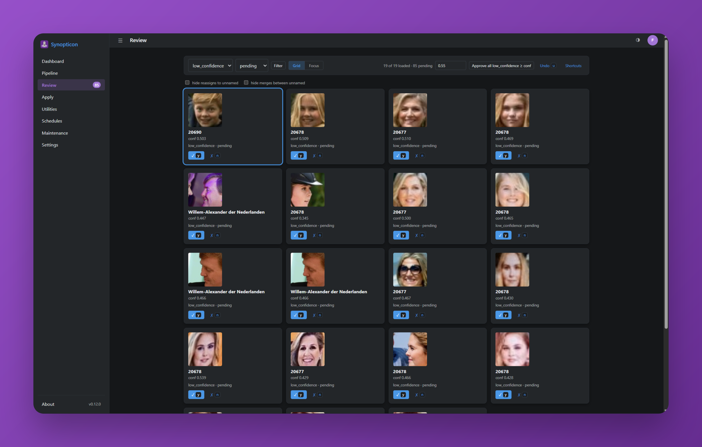
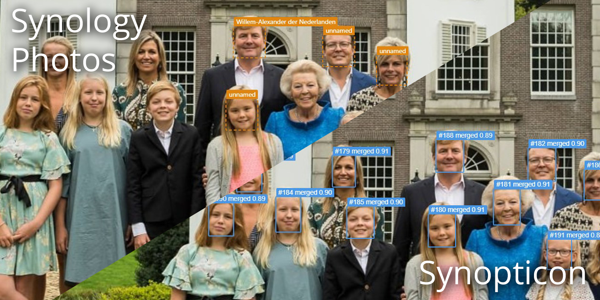
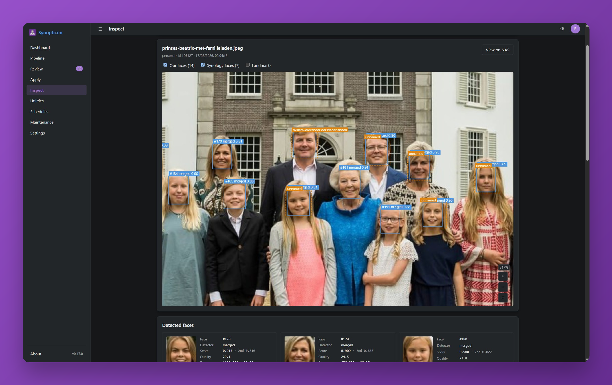
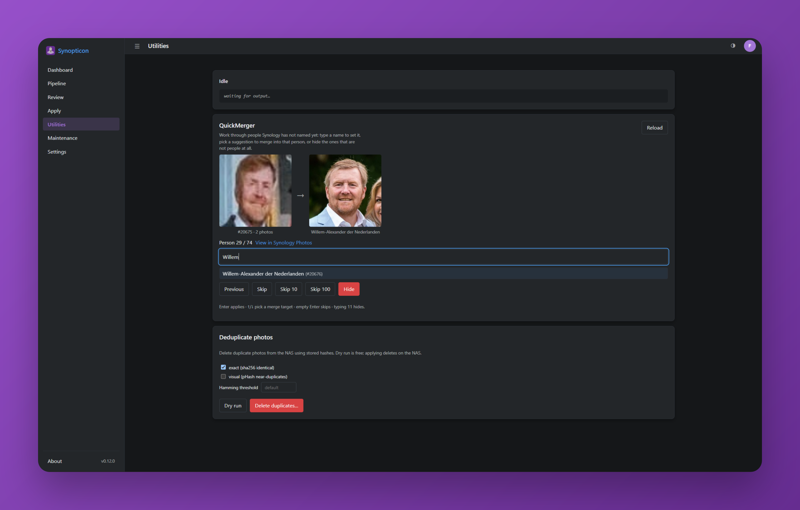
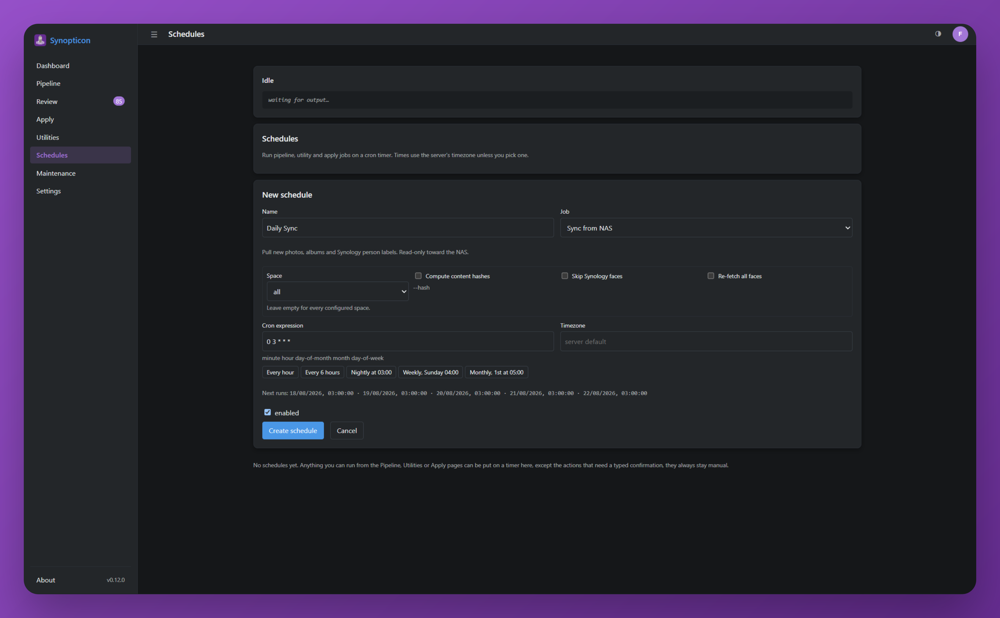

Synopticon is a toolkit to run alongside Synology Photos, consisting of a set of utilities that run over your library and take on the jobs DSM currently does poorly or not at all. It includes enhanced face recognition, robust face grouping, automatic face reassignment, duplicate photo deletion and much more.

**Enhanced face recognition**  
Synology's built-in face detection frequently misses faces, or links photos to the wrong person. Synopticon runs a cutting-edge face detection pipeline over your library, cross-references the results against what Synology already knows, and writes corrections back through Synology Photos' API. Writebacks only occur after your explicit review.



The result is a drastically better hit rate than Synology Photos' baseline face recognition. While Synology Photos often recalls 20% of the faces in a photo, Synopticon hits a ~95% average recall rate.



**QuickMerger**  
Quickly work through unnamed faces in Synology Photos through an ergonomic merge interface, perfect for giving the initial set of faces a name to start working with inside Synopticon.

**Inspect**  
See exactly what Synopticon saw in a single photo: every face it detected, confidence and quality scores, next to the faces Synology found, plus the group each face landed. Clicking faces in the review screen will, conveniently, also take you here.



**Deduplication**  
finds duplicate photos (byte-identical, or visually near-identical) from content hashes computed over your originals, keeps the highest-quality copy of each group, and deletes the rest through Synology's background-task API.



**Scheduled Runs**  
After the initial setup, schedule synchronization with the NAS, face detection and face grouping without having to touch Synopticon. Just come back every now and then to review the groups.



## Quickstart

### Install script

```bash
curl -fsSL https://synopticon.nl/install.sh | bash
```

The script checks your system, installs uv if it's missing, clones the repo into `./synopticon`, builds the web GUI and starts it on http://localhost:8686.

### Manual

Install the requirements:
- Python v3.11-3.12
- Node v22+

1. Clone the repo and setup directory structure
```bash
git clone https://github.com/fdebijl/synopticon && cd synopticon && mkdir -p data models && cp config.example.toml data/config.toml
```

2. Install dependencies and build the web GUI
```bash
uv sync --extra cpu --extra review --extra faiss && cd frontend && npm ci && npm run build && cd ..
```

3. Run the web GUI
```bash
uv run synopticon web
```

4. Point your browser to http://localhost:8686

This spins up the web GUI, which will walk you through the initial setup for Synopticon. This is a great way to play around with all the features of Synopticon, but for long-term deployments you probably want to run it locally using the CLI, or spin up a persistent Docker container. See [Documentation](#documentation) below for how to do just that.

## Documentation

- [Running locally](docs/running-locally.md) — the web GUI and CLI straight from the repo
- [Running with Docker](docs/docker.md) — images, compose, schedules, backups, authentication, reverse proxies
- [CLI reference](docs/cli-reference.md) — every `synopticon` command
- [Configuration](docs/configuration.md) — `config.toml`, the database backend, GPU acceleration, NAS two-factor
- [Models](docs/models.md) — which weights the pipeline needs and how to export AdaFace/MagFace
- [How it works](docs/how-it-works.md) — the face-recognition pipeline and deduplication
- [Safety model](docs/safety-model.md) — what can write to your NAS, and what gates it
- [Compatibility](docs/compatibility.md) — supported DSM versions
- [Glossary](docs/GLOSSARY.md) — the face-recognition vocabulary

## LLM Disclaimer
Parts of this codebase were created by a large language model, in particular models provided by Anthropic.

## Acknowledgments
- [ScreenPastel](https://screenpastel.vercel.app/) is an amazing tool for prettifying screenshots that I used for the screenshots at the top
  - Adding additional screenshots for a new feature? Use #9650C9 to #662D91 at a 135 degree direction as the gradient with a 40px padding
- [FeedbackFruits](https://feedbackfruits.com/) for generously donating many megatokens to this project.
